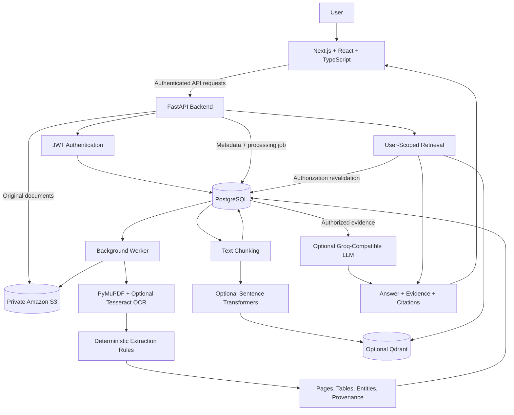
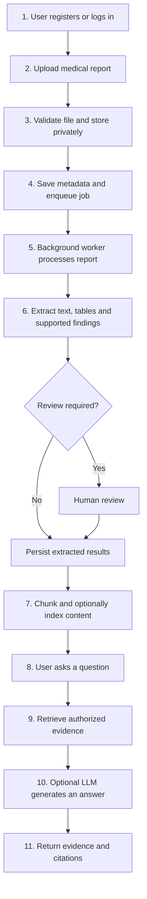

 <div align="center">

# 🩺 Niramaya-AI

### From scattered medical reports to a searchable, evidence-linked health record.

**Upload. Organize. Search. Understand.**

[](https://github.com/YOUR_GITHUB_USERNAME/Niramaya-AI)


[Features](#-features) • [Architecture](#-architecture) • [Workflow](#-how-it-works) • [Security](#-security-first-design) • [Installation](#-getting-started) • [Roadmap](#-roadmap)

</div>

---

## 🌟 About the Project

**Niramaya-AI** is an AI-assisted medical document management and retrieval platform designed to transform scattered medical reports into organized, searchable health records.

It combines deterministic document processing, structured medical information extraction, provenance-aware review, and optional Retrieval-Augmented Generation (RAG) to help users find relevant information across their own records.

Instead of treating medical reports as ordinary PDFs, Niramaya-AI builds a structured information layer around extracted text, report pages, findings, document metadata, and evidence-linked answers.

> **Core principle: Evidence before generation.**
>
> The AI assistant should explain authorized medical evidence rather than invent information about a patient's health.

## 🎯 The Problem

Medical information is often distributed across laboratory reports, prescriptions, imaging reports, discharge summaries, and scanned documents.

This creates several challenges:

- Finding a specific result across multiple reports.
- Organizing medical documents over time.
- Extracting useful information from PDFs and scanned pages.
- Identifying the source behind an answer.
- Preventing one user's private medical information from being exposed to another user.
- Avoiding unsupported AI-generated answers when evidence is missing.

## 💡 The Solution

Niramaya-AI brings document ingestion, processing, storage, retrieval, and optional AI-assisted question answering into one workflow.

### ✨ Features

<details open>
<summary><strong>📄 Medical document processing</strong></summary>

- Upload PDF, JPEG, and PNG files.
- Validate supported file types and file signatures.
- Store original documents in private Amazon S3.
- Extract PDF text using PyMuPDF.
- Optionally process low-text pages with Tesseract OCR.
- Detect supported document types using explicit rules.
- Extract selected medical values, units, labels, and report sections.
- Preserve source-page information and extraction warnings.
- Track processing stages and document status.
- Flag ambiguous or incomplete results for review.

</details>

<details>
<summary><strong>🧠 AI-powered medical record search</strong></summary>

- Store extracted text chunks in PostgreSQL.
- Generate embeddings using Sentence Transformers when configured.
- Use Qdrant for optional vector similarity search.
- Combine lexical and optional vector retrieval.
- Filter retrieval using the authenticated user's identity.
- Revalidate retrieved candidates against PostgreSQL.
- Generate evidence-grounded answers through an optional Groq-compatible LLM.
- Return citations and evidence when available.
- Support evidence-only and insufficient-evidence response states.

</details>

<details>
<summary><strong>🔐 Authentication and data isolation</strong></summary>

- Username/password registration and login.
- Argon2-based password hashing.
- Short-lived HS256 bearer tokens.
- Server-side document ownership checks.
- User-scoped document and chat-history access.
- Private S3 objects and expiring document access links.
- Protected retrieval across PostgreSQL and Qdrant.
- Retryable document processing and deletion jobs.

</details>

<details>
<summary><strong>⚙️ Background processing and reliability</strong></summary>

- PostgreSQL-backed processing outbox.
- Separate polling worker.
- Worker leases and retry handling.
- Processing history and stage tracking.
- Separate extraction and vector-index states.
- Document reprocessing and reindexing workflows.
- Retryable S3 and Qdrant cleanup.

</details>

---

## 🏗️ Architecture

Niramaya-AI uses a modular architecture with a Next.js frontend, FastAPI backend, PostgreSQL as the canonical structured store, private S3 object storage, and optional AI retrieval services.



### Technology Stack

| Layer | Technologies |
|---|---|
| Frontend | Next.js 15, React 19, TypeScript |
| Backend | Python, FastAPI, Pydantic |
| Database | PostgreSQL, SQLAlchemy 2.0, Alembic |
| Object storage | Amazon S3, Boto3 |
| Document processing | PyMuPDF, optional Tesseract OCR |
| Embeddings | Sentence Transformers |
| Vector database | Qdrant, optional |
| AI generation | Groq-compatible API, optional |
| Authentication | Argon2 password hashing, HS256 JWT |
| Testing | pytest, SQLite-based tests, service fakes |
| Frontend checks | ESLint, TypeScript, Next.js production build |

## 🔄 How It Works



### Example User Journey

1. A user creates an account and signs in.
2. The user uploads a synthetic or otherwise appropriately authorized medical report.
3. The backend stores the original file in private S3 and records its metadata in PostgreSQL.
4. A background worker extracts available text and supported structured findings.
5. Results, page references, processing states, and review warnings are persisted.
6. Extracted content can be indexed for lexical and optional semantic retrieval.
7. The user asks a question about their own records.
8. The backend retrieves evidence belonging to that authenticated user.
9. The optional LLM receives only authorized evidence.
10. The assistant returns an answer with citations when available.

**Important:** uploading a document successfully means that storage and job creation succeeded. It does not guarantee that processing or indexing has completed.

## 🛡️ Security-First Design

Medical information requires careful isolation and explicit trust boundaries.

Niramaya-AI applies the following design principles:

- **Identity from authentication:** the backend derives the user identity from the verified token, never from a user-supplied `user_id`.
- **Database authorization:** document and child-record queries apply explicit ownership filters.
- **Vector revalidation:** Qdrant returns candidate identifiers; PostgreSQL independently validates ownership and current document generation before evidence is used.
- **Private document storage:** original reports are stored as private S3 objects.
- **Short-lived access:** viewing and download links expire.
- **Secret separation:** cloud and model credentials belong in environment configuration or an appropriate secret manager.
- **Untrusted input:** uploaded documents and extracted content are treated as data, not executable instructions.
- **Safe failures:** errors should not disclose credentials, raw provider responses, or sensitive document content.

<details>
<summary><strong>Security limitations to address before production</strong></summary>

- Browser bearer tokens currently use `sessionStorage` and are accessible to same-origin JavaScript.
- Rate limiting is process-local and is not shared across API replicas.
- PostgreSQL RLS and migration behavior require live verification using the intended least-privilege database role.
- Automated tests do not establish live AWS, Qdrant, LLM, or OCR infrastructure readiness.
- Local Compose, production container targets, and CI migration/image build validation are included; cloud deployment, production monitoring, backup/restore automation, and account-wide erasure are not implemented.

These limitations must be addressed according to the intended deployment's security and privacy requirements.

</details>

## 🗃️ Data Storage Strategy

| Component | Responsibility |
|---|---|
| PostgreSQL | Users, document metadata, extracted entities, page text, tables, chunks, chat history, processing jobs and state events |
| Amazon S3 | Original uploaded document bytes |
| Qdrant | Optional vector index used to retrieve candidate chunk IDs |
| Local embedding model | Converts text and questions into vector representations |
| Optional LLM provider | Generates answers from evidence authorized by the backend |

**Why keep PostgreSQL canonical?**

The vector database is an index, not the authority for medical-record ownership. Keeping chunk text and ownership information in PostgreSQL allows the backend to validate candidates independently before using their content as evidence.

## 🔌 API Overview

The documented API includes the following workflows. Exact routes should be confirmed against the running application's OpenAPI documentation.

| Method | Endpoint | Purpose |
|---|---|---|
| `POST` | `/api/v1/users/register` | Register an account |
| `POST` | `/api/v1/users/login` | Authenticate a user |
| `GET` | `/api/v1/users/me` | Retrieve the current user |
| `POST` | `/api/v1/documents/upload` | Upload and enqueue a document |
| `GET` | `/api/v1/documents` | List authorized documents |
| `GET` | `/api/v1/documents/{id}/status` | Retrieve processing status |
| `GET` | `/api/v1/documents/{id}/extractions` | Retrieve extracted entities |
| `GET` | `/api/v1/documents/{id}/pages` | Retrieve extracted page text |
| `POST` | `/api/v1/documents/{id}/reprocess` | Reprocess a document |
| `POST` | `/api/v1/documents/{id}/reindex` | Rebuild its optional vector index |
| `DELETE` | `/api/v1/documents/{id}` | Start owner-authorized deletion |
| `POST` | `/api/v1/health/ask` | Ask a question about authorized records |
| `GET` | `/api/v1/health/history` | Retrieve the current user's chat history |

When running locally, open:

`http://localhost:8000/docs`

FastAPI's interactive documentation is the best place to verify the exact routes exposed by your current branch.

## 🚀 Getting Started

### Prerequisites

- Python 3.12
- Node.js 20
- PostgreSQL
- Optional Tesseract OCR installation
- Optional S3, Qdrant, and LLM provider configuration

### 1. Clone the repository

```bash
git clone https://github.com/YOUR_GITHUB_USERNAME/Niramaya-AI.git
cd Niramaya-AI
```

### 2. Set up the backend

```bash
python -m venv .venv
source .venv/bin/activate

python -m pip install --require-hashes -r requirements-dev.txt

if [ ! -f .env ]; then cp .env.example .env; fi
```

Configure your local `.env` file with the PostgreSQL connection URL and a strong, randomly generated JWT signing secret.

Never commit `.env` or real credentials.

### 3. Apply database migrations

```bash
alembic history
alembic upgrade head
```

Review the migration history and confirm the target database before applying schema changes.

### 4. Run the FastAPI server

```bash
uvicorn app.main:app --reload --host 127.0.0.1 --port 8000
```

API documentation:

`http://localhost:8000/docs`

### 5. Start the background worker

Open another terminal:

```bash
cd Niramaya-AI
source .venv/bin/activate
python -m app.documents.worker
```

### 6. Start the frontend

Open a third terminal:

```bash
cd Niramaya-AI/frontend
npm ci
npm run dev
```

Configure `NEXT_PUBLIC_API_BASE_URL` if the backend is running at a different address.

## 🧪 Testing

### Backend

```bash
python -m compileall -q app tests

QDRANT_URL= QDRANT_API_KEY= LLM_API_KEY= \
AWS_ACCESS_KEY_ID= AWS_SECRET_ACCESS_KEY= \
python -m pytest -q
```

Run isolated tests without accidentally connecting to live cloud services.

### Frontend

```bash
cd frontend

npm ci
npm run lint
npx tsc --noEmit --incremental false
npm run build
```

These checks cover automated backend tests and frontend static/build validation. They do not prove production deployment readiness or live integration correctness.

## ⚠️ Known Limitations

Niramaya-AI is an engineering prototype, and its capabilities have defined boundaries.

- Extraction supports a finite set of explicit report labels and rules.
- OCR requires a correctly installed Tesseract binary and language data.
- Table detection can be incomplete.
- Vector search is optional and depends on Qdrant and embedding configuration.
- No separate learned reranker is currently included.
- Evidence-constrained LLM generation does not guarantee medical correctness.
- The implementation is not clinically validated.
- Local integration containers and CI migration/image builds are included. Production infrastructure automation, monitoring, verified backup/restore, and full account-wide erasure are not included.
- Browser end-to-end tests and independent security validation remain outstanding.

## 🗺️ Roadmap

The following are proposed improvements, not claims of existing functionality.

- [ ] Add PostgreSQL RLS integration tests with a least-privilege runtime role.
- [ ] Add opt-in integration tests using isolated S3 and Qdrant resources.
- [ ] Introduce browser end-to-end and accessibility testing.
- [ ] Add distributed rate limiting.
- [ ] Evaluate a safer production session architecture.
- [ ] Implement coordinated account deletion and cross-service erasure.
- [ ] Define backup, recovery, retention, and data-export policies.
- [ ] Add production metrics, monitoring, and alerting.
- [ ] Pin reviewed embedding model revisions and document reindexing procedures.
- [ ] Add image provenance/SBOM and secret scanning.
- [ ] Establish production deployment automation after security and operational requirements are defined.

## 🤝 Contributing

Contributions that improve security, reliability, traceability, extraction quality, and developer experience are welcome.

1. Open an issue describing the problem or proposed improvement.
2. Keep pull requests focused and testable.
3. Add tests for behavior changes.
4. Use synthetic or appropriately de-identified test data.
5. Document new extraction rules and supported formats.
6. Never commit real patient reports, API keys, passwords, or sensitive logs.

## 📚 Documentation

The project's engineering documentation covers:

- System architecture and design decisions.
- Frontend and backend module structure.
- API contracts and database schema.
- Authentication and authorization.
- Document processing and state transitions.
- Medical-data extraction and provenance.
- Chunking, embeddings, vector indexing, and RAG.
- Security, privacy, and threat modeling.
- Configuration, deployment, troubleshooting, and testing.
- Operational runbooks and known limitations.

Refer to the project's [Engineering Manual](docs/index.md) and [`docs/`](docs/) directory for detailed implementation and operational guidance, including [System Architecture](docs/03-system-architecture.md), [Security & Privacy](docs/21-security-and-privacy.md), and [API Reference](docs/08-api-reference.md).

## ⚕️ Medical Disclaimer

**Niramaya-AI is an engineering prototype for medical document organization and evidence retrieval. It is not a diagnostic system, medical device, emergency service, or validated clinical decision-support tool.**

Extracted information may be incomplete or incorrect. AI-generated answers may also be wrong, even when citations are provided. Always review the original medical report and consult a qualified healthcare professional before making medical decisions.

Do not upload real patient data until the applicable legal, privacy, security, and clinical reviews have been completed.

---

<div align="center">

### Built around one principle: make medical records searchable, with evidence you can inspect.

**Niramaya-AI — Organize records. Retrieve evidence. Understand information.**

</div>
