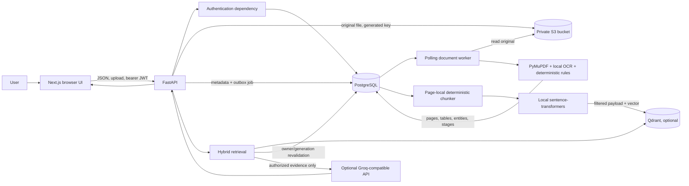

# System architecture

## System context

## Runtime boundaries

- **Browser:** renders routes and calls the API through `frontend/lib/api.ts`. It stores the access token in `sessionStorage`; it is not an authorization boundary. It contains no server credentials.
- **FastAPI:** validates request DTOs, resolves the active user, enforces ownership and coordinates storage/database/service calls. `/health` verifies a DB query only.
- **PostgreSQL:** source of truth for account, document metadata, extracted output, chunks, state/job ledgers, and chat history. Explicit application owner predicates are mandatory; PostgreSQL RLS adds defense in depth where migrations define policies.
- **S3:** stores original bytes as private objects. PostgreSQL stores the opaque object key and metadata, not the file bytes.
- **Worker:** claims durable pending jobs from PostgreSQL, obtains source objects via S3, runs local deterministic parsing and a separate indexing stage. It uses leases and bounded retry state.
- **Qdrant:** optional, rebuildable similarity index. It returns chunk identifiers; no returned text is trusted as authorization.
- **Embedding model:** local Sentence Transformers model used for both indexing and query vectors; independent of LLM generation.
- **LLM provider:** optional OpenAI-compatible chat-completions API. It receives the question plus only PostgreSQL-authorized evidence, never a user ID to select records.

## Trust and failure boundaries

Uploaded reports, extracted content, vector payloads and model output are untrusted. Authorization occurs in the backend before evidence construction. S3, Qdrant and LLM network errors must not disclose provider response bodies. Vector failure is intended to leave PostgreSQL lexical chunks available. Processing state and vector-index state are separate so indexing failure does not falsify extraction completion.

For detailed paths see [upload and processing](diagrams/document-upload-flow.mmd), [state machine](diagrams/document-state-machine.mmd), [RAG retrieval](diagrams/rag-retrieval-flow.mmd), and [data-flow catalogue](34-data-flow-catalog.md).
