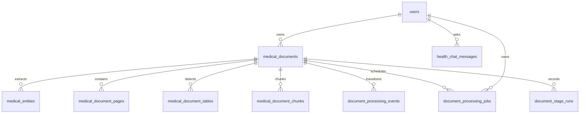

# Database schema

SQLAlchemy model definitions are in `app/user/models.py`, `app/health/models.py`, and `app/documents/models.py`. Alembic migrations, not ORM startup, create deployed schema. PostgreSQL is the expected service; SQLite is used in tests and does not reproduce PostgreSQL RLS, FTS, locking or all JSON behavior.

## Entity relationships

## Tables and purpose

| Table | Stored data | Important isolation/integrity |
| --- | --- | --- |
| `users` | UUID, normalized username/email, password hash, active flag and timestamps | Unique indexes on username and email. Public DTO excludes hash. |
| `medical_documents` | Owner, original name/type/date/content type/size, opaque S3 key, upload and processing state, generation, indexing state, safe metadata JSON | Owner indexes; unique `(id,user_id)` supports composite child FKs; file size nonnegative. |
| `medical_entities` | Category/name/value/unit, normalized value/unit, range/flag, page, excerpt, rule, score, warnings/review status | Owner/document FK with cascade; extraction generation. |
| `medical_document_pages` | Current and prior generation page text, extraction method, OCR status/warnings | Unique doc/generation/page and owner/document FK. Page text is sensitive. |
| `medical_document_tables` | Per-page headers, rows, extraction method and warnings | Unique doc/generation/page/table and owner/document FK. |
| `medical_document_chunks` | Chunk text/hash/index/page/section/generation/model metadata | Owner/document FK; PostgreSQL is canonical text store. |
| `health_chat_messages` | User question, answer, citations, generation status and time | User FK and owner/time index; sensitive data; history query filters user. |
| `document_processing_events` | Previous/next state, actor, reason, version and time | Unique owner/doc/version; safe reason codes. |
| `document_stage_runs` | Stage status/attempt/times/reason by generation | Unique owner/doc/generation/stage; owner/document FK. |
| `document_processing_jobs` | `process`, `index`, or `delete` work, attempts, lease, schedule, idempotency and reason | Unique idempotency key; claim and owner/document indexes. |

The optional vector index holds vector point identifiers and metadata in Qdrant; it is not the authoritative content/authorization database. Current migration head is `0007_chat_generation_status`; see [migration ledger](11-database-migrations.md) and [database objects](reference/database-object-inventory.md).
