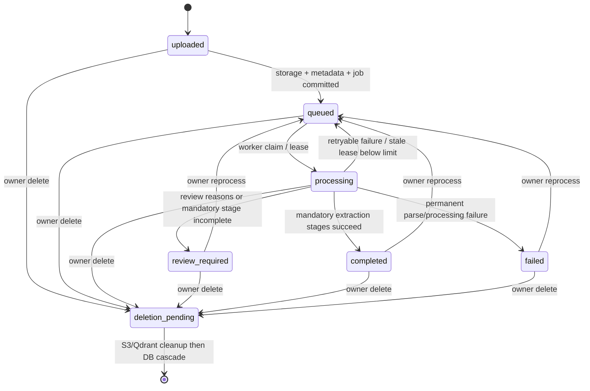

# Document state machine and job lifecycle

`app/documents/processing.py` guards transitions under a row lock and writes `document_processing_events` with monotonically increasing `state_version`. `document_stage_runs` describes work within one `processing_generation`; `document_processing_jobs` is the durable outbox/lease queue. The processing state and vector-index state are different dimensions.

The complete transition map is `ALLOWED_TRANSITIONS` in source; `deletion_pending` is terminal. `transition_document` rejects illegal state changes and optionally checks expected version. A document can only become `completed` once mandatory stage records succeeded; the default deterministic path records classification, text, entity, normalization, provenance and review evaluation, with tables optional. Vector indexing is independent by default; `HEALTH_VECTOR_INDEX_REQUIRED` affects adapter mode/required-stage checks but the built-in deterministic worker records indexing separately.

## Retry and recovery

Jobs begin pending, are claimed with a lock and `locked_until`, and carry `attempts`/`max_attempts` (default five). `retry_delay` grows exponentially from five seconds to at most one hour. Worker lease renewal occurs while adapter stages run. Stale process leases are returned to queued while attempts remain; exhausted work fails. Indexing has its own retry job and does not rerun OCR. Delete jobs retry S3/vector cleanup. User-triggered reprocess creates a new extraction generation so stale results cannot be mixed with current results.

See [processing test inventory](testing/document-processing-tests.md) and [operational steps](36-operational-runbooks.md).
