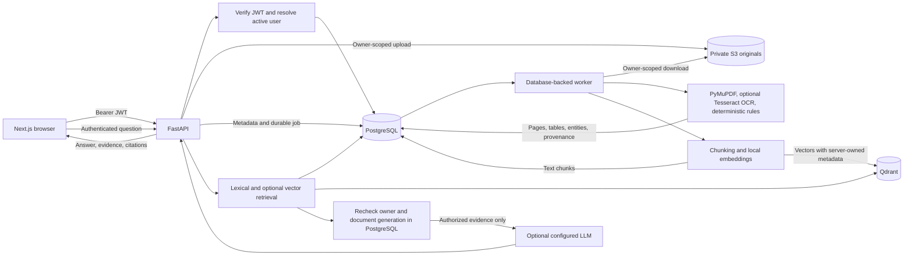

# Niramaya-AI architecture

Niramaya-AI separates account access, original-file storage, deterministic report processing, and health-record question answering. PostgreSQL is the source of truth for ownership, metadata, extracted results, chunks, and conversation history.

## System flow

## Components and data ownership

- **Next.js frontend:** registration, login, document workflows, extracted-result review, and health questions. It sends bearer tokens to the API and never receives cloud credentials.
- **FastAPI:** validates requests, verifies JWTs, resolves the current active user, enforces ownership, and returns safe response DTOs.
- **PostgreSQL:** stores users, document metadata, processing jobs and events, extracted pages/tables/entities, text chunks, and user-scoped chat history. Alembic manages schema changes; application startup does not create tables.
- **Private S3:** stores original uploaded PDFs and supported images under server-generated object keys. PostgreSQL stores the key and metadata, not AWS credentials.
- **Worker:** claims durable jobs, downloads an authorized source object, extracts embedded text and tables, uses local Tesseract for OCR when configured, classifies reports and extracts supported values with deterministic rules, then stores provenance and stage outcomes.
- **Chunking and embeddings:** creates page-aware text chunks and local vectors using the configured sentence-transformer model. PostgreSQL stores chunk text; Qdrant stores vectors and retrieval metadata.
- **Qdrant:** narrows semantic search with a mandatory server-generated `user_id` filter and optional document/date/type filters. Its point IDs are untrusted until PostgreSQL verifies each result.
- **LLM provider:** optional. The API sends the question and only evidence retrieved and authorized by the backend. Report processing itself does not call the LLM.

## Authentication and authorization boundary

1. The API verifies the bearer token's signature, expiry, and configured issuer/audience, then resolves the token subject to an active user record.
2. Every document, chunk, and chat-history operation uses that verified user ID. Client-supplied owner IDs are rejected or ignored by the relevant data access paths.
3. PostgreSQL queries include explicit owner predicates and set transaction-local RLS context where supported. RLS adds defense in depth; it does not replace application filters.
4. Vector retrieval includes server-controlled owner metadata. Returned IDs are reloaded from PostgreSQL using owner, document, upload-state, and active-generation predicates before any text is returned to the model.
5. Citations are built by the backend from authorized document metadata and page provenance.

## Failure behavior

- PostgreSQL availability is checked by `/health`; that endpoint does not verify S3, Qdrant, Groq, or worker health.
- Qdrant and embedding failures are recorded as indexing failures. Persisted text chunks remain available to owner-scoped keyword retrieval; vector search is an enhancement.
- If answer generation is disabled or unavailable, the API can return evidence-only output. Empty retrieval does not invent a medical value.
- Processing status and stage history come from persisted database state, not frontend assumptions.

## Further reading

- [Data flow](architecture/data-flow.md)
- [User-scoped retrieval](security/user-scoped-retrieval.md)
- [Document processing](medical-data/document-processing.md)
- [Database model](database/data-model.md)
