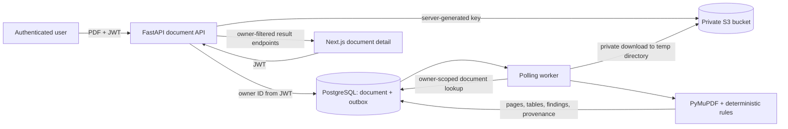

# Medical document processing data flow

The deterministic extraction/parser stage does not call an LLM, generative model, hosted embedding API, or remote OCR service. After extraction, the worker may run local embeddings and contact configured Qdrant for indexing. Result records are visible only through authenticated endpoints that resolve ownership from the verified token. Original files stay in private S3; temporary source/conversion files are removed after processing.
