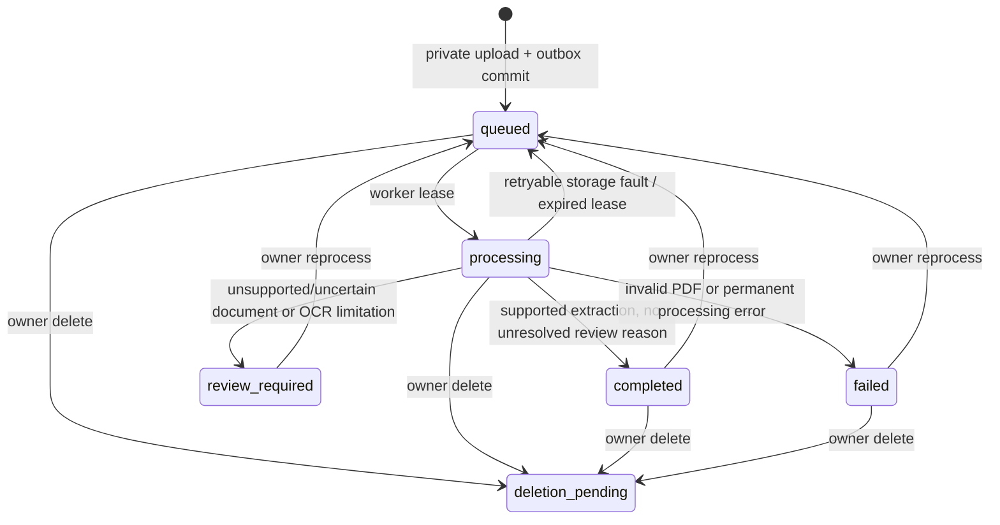

# Medical document processing lifecycle

## Scope

The default worker now runs a local, deterministic PDF pipeline. It does not call an LLM, hosted OCR, embedding service, or any generative model. PDFs and uploaded JPEG/PNG images are downloaded from private S3 to a temporary local directory. Images are wrapped as one-page PDFs and sent through the same local OCR path; temporary source and conversion files are deleted afterward.

## Lifecycle

The upload transaction records the document, a state event, and an outbox job. Workers use bounded leases and retry transient storage failures. Each reprocess increments `processing_generation`; persisted results and stage records are scoped to that generation. Only an authenticated owner can read results or request reprocessing.

## Pipeline stages

1. Classification uses explicit document keywords and rules.
2. PyMuPDF extracts page text and attempts table detection.
3. Optional local Tesseract OCR runs only when enabled and available for pages with little or no text.
4. Explicit aliases parse selected laboratory values and qualitative results.
5. A small set of unit conversions are applied only when a recognized unit is present.
6. Each finding stores page, source line, rule version, extraction method, warnings, and a heuristic parsing-quality score.
7. Review evaluation records unresolved conditions. Scores are not probabilities, clinical confidence, or a diagnosis.

Unsupported pages, ambiguous documents, encrypted/corrupt/oversized PDFs, unavailable OCR for scan-only pages, and configured vector indexing requirements prevent a false `completed` state. No embedding or vector index is currently configured by this local processor.

## Limits and operation

`DOCUMENT_MAX_PAGES`, `DOCUMENT_MAX_TEXT_CHARS`, `S3_MAX_UPLOAD_BYTES`, and the `OCR_*` settings bound work. OCR is opt-in operationally through local Tesseract availability; configure `TESSERACT_CMD` if it is outside PATH. Processing is offline and has no model-provider configuration. See the [runbook](../operations/document-processing-runbook.md).

On macOS, install the local OCR executable with `brew install tesseract`; install the desired trained language data on the host and set `OCR_LANGUAGE` accordingly. On Linux, install the distribution's `tesseract-ocr` package and language pack (for example, English). Keep OCR disabled or accept a review outcome when those system packages are unavailable.
